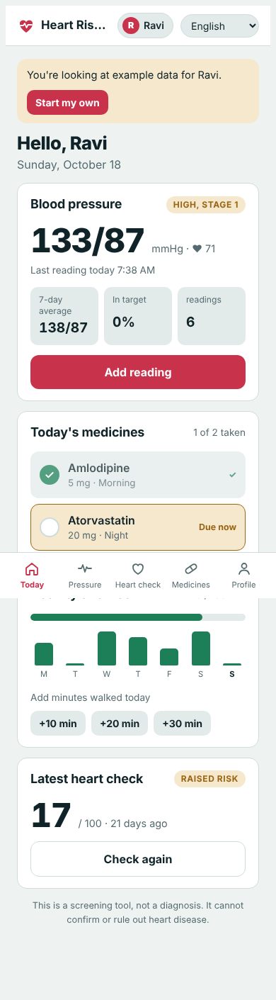
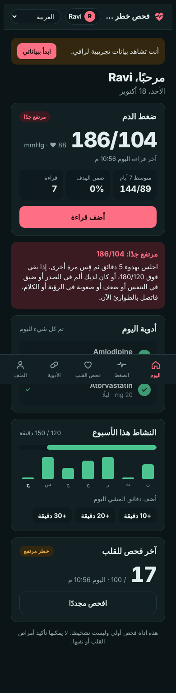
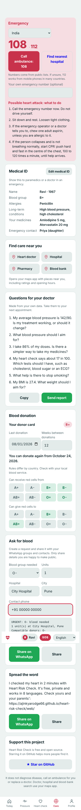

# Heart Risk Check

A heart-health companion for any phone: a blood-pressure log, medicine reminders, family profiles and a two-minute heart-disease check that needs no blood test. It works in 8 languages and runs fully on the device, so no health data leaves the phone.

<p>
  
  &nbsp;
  
  &nbsp;
  
</p>

**Live demo:** _add your public link here_

## Why

Heart and blood-vessel disease killed about 19.8 million people in 2022. More than three-quarters of those deaths were in low- and middle-income countries, where early check-ups are rare ([WHO](https://www.who.int/News-Room/Fact-Sheets/Detail/Cardiovascular-Diseases-(Cvds))). Most risk calculators need a cholesterol blood test. This one needs only 13 questions that anyone can answer.

## Get the app

- **Use it now:** https://ajinkyarodge66.github.io/heart-risk-check/web/
- **Install on Android:** open the link in Chrome and choose Install app.
- **Install on iPhone:** open the link in Safari, tap Share, then Add to Home Screen.
- **Google Play:** see [docs/PUBLISH_TO_PLAY_STORE.md](docs/PUBLISH_TO_PLAY_STORE.md). The PNG icons, maskable icon, screenshots, privacy policy and store listing are all ready.

## Features

**Version 2: heart-health companion**
- **Blood-pressure log.** Readings are classified against the ACC/AHA 2017 categories, with 7- and 30-day averages, time in target, a 30-day chart, and an emergency warning above 180/120.
- **Medicines.** A daily dose checklist highlights doses that are due, and tracks a 7-day adherence rate and a streak.
- **Activity and weight.** Weekly minutes against the 150-minute goal, plus a weight log with BMI.
- **Family profiles.** Track parents or a partner on one phone, each with separate data.
- **Doctor report.** A one-page summary to copy or save as a file.
- **Backup.** Export and import a JSON file. All data stays in the phone's browser storage.
- **Connected heart check.** It uses the profile and logged readings, warns when the readings suggest high blood pressure, and keeps a history of past checks.

**Pro: field-ready**
- **Installable and offline.** Add it to the home screen on Android or iPhone. A service worker keeps it working without internet after the first visit.
- **Health-worker mode** for community screening and pilots:
  - screen many people in a row using a person code instead of names, with a consent tick and place
  - record measured blood pressure next to the questionnaire
  - referral is suggested automatically for high risk or a reading of 140/90 or more
  - live counts: screened, high risk, referred, and **new high blood pressure found**
  - export everything as a CSV ready for the pilot analysis

**Care and emergency (version 3)**
- **SOS button** on every screen:
  - verified ambulance numbers for 46 countries, picked automatically from the phone's region, plus a slot for your own number
  - one tap to call, or to find the nearest hospital
  - heart-attack first aid and CPR steps
- **"How urgent is it?" symptom check.** Ten red-flag symptoms, including heart attack, stroke (the FAST signs), hypertensive crisis and heart failure, sorted into four answers: call an ambulance now, get help today, book an appointment, or no warning signs. It tells you how urgent things are; it does not give a diagnosis.
- **Talk to a doctor or nurse.** Links to free official services: India's eSanjeevani video consultations, NHS 111 in the UK, healthdirect in Australia and 811 in Canada. Every country also gets a "doctor near you" search and an online-doctor search.
- **Medical ID** for paramedics: blood group, allergies, conditions, current medicines and an emergency contact.
- **Medical history from birth:** a timeline of diagnoses, operations, hospital stays, vaccines and test results, plus family history. All of it goes into the doctor report.
- **Find care near you:** heart doctor, hospital, pharmacy and blood bank, opened in the phone's maps app with real ratings.
- **Questions for your doctor,** generated from the person's own readings, adherence and risk. Send them with the report on WhatsApp.
- **Blood donation:**
  - a donor card with the next date you can donate
  - an ABO/Rh red-cell compatibility chart
  - an "Ask for blood" message builder that lists compatible donors and shares to WhatsApp
- **Donor recognition:**
  - a donation log, "people helped" count and six badges, from First drop to Legend
  - a one-tap "I donated" share
  - no money or discounts, because voluntary unpaid donation is the WHO standard and paid donation is illegal in places such as India
- **SOS location:** sends your GPS location to your emergency contact by WhatsApp or SMS.
- **Scam warning:** every blood request includes "Never send money for blood".
- **Sharing and growth:** share buttons, Star on GitHub, and an About page covering mission, privacy, the model and its limits.

**Blueprint alignment (version 5.0)**: see [docs/BLUEPRINT_STATUS.md](docs/BLUEPRINT_STATUS.md)
- **First-run screen:** what the app does and doesn't do, with a stored consent record.
- **Data provenance:** every reading is labelled Typed or Read from photo, with optional notes, plus missing-data notes on charts.
- **Labelling and warnings:** the risk model is labelled "Research model", with a warning for under-45s (where the model's sensitivity is low).
- **Reviewed Learn library** (AHA, NHS and WHO, with review dates). The AI coach cites it and has a "Report this answer" button and a prompt-injection guard.
- **Your data:** CSV export, delete all data, consent history.
- **AHA 2025 wording:** a reading above 180/120 without symptoms now means "call your doctor"; with symptoms, "call emergency services".
- **Governance documents:** [model evaluation](docs/model-evaluation.md) (bootstrap CIs, calibration, subgroups), [product requirements](docs/product-requirements.md), [privacy data map](docs/privacy-data-map.md), [threat model](docs/threat-model.md), [clinical risk register](docs/clinical-risk-register.md), [AI safety evals](docs/ai-safety-evals.md), [release gates](docs/release-gates.md), [decisions](docs/decisions.md).

**Security hardening (version 4.3)**: see [SECURITY.md](SECURITY.md)
- 600,000-round PBKDF2 key, 6–12 digit PINs, a brute-force throttle (30 seconds, doubling each time) and encrypted backups.
- All code is built into the page (the QR library is vendored) and a strict Content Security Policy is applied on GitHub Pages.

**Security and doctor sharing (version 4.2)**
- **App lock with on-device encryption:** a PIN is turned into a 256-bit key with PBKDF2-SHA256 (250,000 iterations), and all data is stored encrypted with AES-256-GCM. No readable copy is kept. The app locks itself after 5 minutes in the background, and SOS still works on the lock screen. A forgotten PIN can't be recovered, by design.
- **"Show to doctor" QR code:** the doctor scans it with their phone camera and sees the patient's summary instantly: blood group, allergies, conditions, medicines, BP averages, risk screen, history and family history. It works offline with no upload.
- **About the creator** section.

**AI and launch tools (version 4.1)**
- **AI heart coach:** answers questions using the person's own readings, in their language, with safety rules built in: no diagnosis, no medicine changes, and emergencies go to the ambulance number first. The person's name is never sent.
- **Read BP from a photo:** take a photo of the monitor's screen and the AI fills in the numbers for the user to check before saving.
- These two AI features run on the Claude runtime in the Claude-hosted version. On GitHub Pages they stay hidden until a server with an API key is added.
- **Feedback:** a star rating and comments, sent as a GitHub issue.
- **"Help launch the app":** a ready-made invite to recruit the 12 Google Play testers.

**Heart check**

- **No lab tests.** People can answer "Not sure" for blood pressure and cholesterol; the app then tells them to get tested.
- **Private.** The model runs in the browser and stores nothing on a server.
- **8 languages:** English, Español, Français, Português, हिन्दी, العربية (right-to-left), Kiswahili, 中文.
- **Clear results.** "X in 100 people like you", a 100-dot picture, the factors that raise or lower the score, what-if changes, next steps and emergency warning signs.
- **Works anywhere.** Metric or imperial units, phone-first layout, light and dark themes.

## Model

| Model | Recall | Precision | F1 | ROC AUC |
| --- | --- | --- | --- | --- |
| Report model (15 features, tuned threshold) | 55.1% | 31.9% | 0.404 | 0.836 |
| **App model (13 features, tuned threshold)** | 54.3% | 31.9% | 0.402 | 0.832 |
| App model, screening cut-off 0.5 | 80.3% | 22.5% | 0.351 | 0.832 |

- **Data:** 129,988 adults from the CDC BRFSS 2015 survey; 9.35% have heart disease or have had a heart attack.
- **Pipeline:** StandardScaler → degree-2 polynomial and interaction features → StandardScaler → logistic regression with balanced class weights.
- **Threshold:** chosen to maximise F1 on out-of-fold predictions from the training set only.
- **Global version:** drops Income and Education, which use US-specific bands. It loses almost no accuracy.
- **Calibration:** the app converts the balanced model's score back to the real 9.35% prevalence before showing "X in 100".
- **Evaluation:** 80/20 stratified split, `random_state=42`; all metrics are on the 25,998-person test set.

The full analysis comparing logistic regression, decision tree, random forest and a neural network is in [`notebook/`](notebook/heart_attack_analysis.ipynb) and [`docs/report.pdf`](docs/report.pdf).

## Project structure

```
model/           train_global.py  → trains the model and exports model_global.json
web/             the phone app: app_src.html + core.js (model maths) + i18n.js / i18n2.js (translations)
                 build.py → builds the self-contained index.html
                 test_parity.js → checks the JS model matches scikit-learn
streamlit_app/   Python version with batch CSV scoring and model diagnostics
notebook/        original analysis
docs/            report and screenshots
data/            put heart_attack.csv here (not committed)
```

## Run it

```bash
pip install scikit-learn pandas numpy

# 1. Train the model (about 2 minutes)
python model/train_global.py data/heart_attack.csv

# 2. Build the web app and check it
python web/build.py
node web/test_parity.js

# 3. Open web/index.html in a browser, or host the web/ folder on GitHub Pages
```

Streamlit version:

```bash
cd streamlit_app
pip install -r requirements.txt
cp ../data/heart_attack.csv . && python train_model.py
streamlit run app.py
```

## Limitations

- **Survey data.** The model is trained on self-reported answers, so it is a **screening aid, not a diagnosis**.
- **US data only.** It must be validated in each new country before anyone relies on it.
- **Machine translations.** They were written without native-speaker review. Please open an issue if you can improve one.
- **Prevalence, not a forecast.** It estimates how likely someone is to have heart disease now, not their 10-year risk.

## Roadmap

- [ ] Native-speaker review of all 8 languages
- [ ] Pilot with a partner organisation in one country (500 people, app plus measured blood pressure)
- [ ] Retrain and recalibrate on local data
- [ ] Offline Android app

## License

MIT. See [LICENSE](LICENSE).
